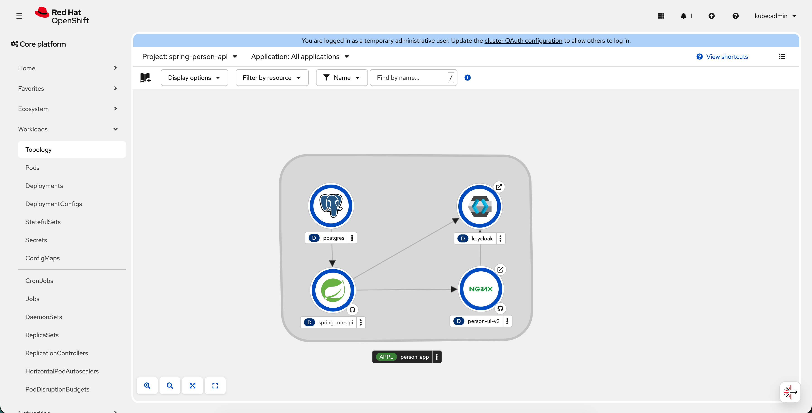

# Person UI

Web UI for the [Person API](../spring-person-api-claude) (`spring-person-api-claude`): persons and their tasks, with
sign-in through Keycloak (realm `person`, roles `person-viewer` and `person-editor`). Built from the
[crud-ui-blueprint](https://github.com/mmartofel/crud-ui-blueprint) template (release in `.blueprint-version`): every
screen comes from the API's OpenAPI contract and `ui-manifest.yaml`.

Stack: Vite, React, TypeScript (strict), React Router, Tailwind CSS v4, shadcn/ui, TanStack Query and Table, React
Hook Form + Zod, orval, i18next, Vitest + Testing Library, Playwright.

## Prerequisites
- Node.js 24+ and npm 11+, [Claude Code](https://claude.com/claude-code), the GitHub CLI (`gh`).
- An API whose contract passes the `contract-auditor` (rules in `docs/API-CONTRACT.md`). A new Spring Boot API
  starts from `docs/API-KICKSTART.md`: three files to copy and one prompt.
- An OIDC provider with a public client: Authorization Code + PKCE, redirect URI `http://localhost:5173/*`, one read
  role and one write role in an access token claim (`VITE_OIDC_ROLES_CLAIM`, default Keycloak's `realm_access.roles`),
  and two users for the e2e tests. Tested with Keycloak; the e2e login helper fills Keycloak's login form, so another
  provider needs `e2e/support/auth.ts` adapted.

## Claude Code setup
The repository brings its own Claude Code configuration: skills and agents in `.claude/`, hooks that run the typecheck
and ESLint on every edited TypeScript file (`.claude/settings.json`), and three MCP servers in `.mcp.json` that the
first session asks you to approve: Playwright (opens the app for checks), shadcn (adds components) and
[Context7](https://context7.com) (current docs of the stack's libraries; no account needed, an API key only raises its
rate limit).

### Recommended Claude Code plugins
Installed by each user, not committed. Most are in the official marketplace, usually already added
(`/plugin marketplace add anthropics/claude-plugins-official`); install with `/plugin install <name>@claude-plugins-official`.

| Plugin | Where | Used for |
|---|---|---|
| `frontend-design` | this UI | a new look: the brand step of `crud-ui-init`, changes to `src/styles/theme.css` or `docs/DESIGN.md` |
| `pr-review-toolkit` | this UI | reviewing a branch before it is pushed (code, tests, error handling, comments) |
| `skill-creator` | this UI | running the skill evals after a skill or agent changed (see "Skill evals") |
| `spring-boot-template` | API repos | building and testing a Spring Boot API from `docs/API-KICKSTART.md`; not in the official marketplace: `/plugin marketplace add piomin/claude-ai-spring-boot`, then `/plugin install spring-boot-template@piomin` |

## Start a project

```bash
gh repo create my-ui --template mmartofel/crud-ui-blueprint --public --clone
cd my-ui
npm install
npx playwright install chromium   # once, for the e2e tests
claude                            # then: "init the project" (crud-ui-init skill)
```

`crud-ui-init` asks for the app name, languages, contract source, OIDC settings and roles, writes `.env.local` and the
manifest, and builds every resource with `crud-resource`. To do it by hand: copy `.env.example` to `.env.local`,
fill it in, set `app` in `ui-manifest.yaml`, and follow the method below.

`crud-ui-init` also records the blueprint release the project starts from in `.blueprint-version` (by hand: the
first version in `CHANGELOG.md`), so later blueprint fixes can be taken over.

## Upgrade from the blueprint
A project created from the template shares no history with it. To take over a newer blueprint release (generic
components, skills, agents, API docs, tooling) while keeping your resources, theme and locales, say "upgrade from the
blueprint" in Claude Code (`blueprint-upgrade` skill), or run `scripts/blueprint-upgrade.sh` and follow
[docs/UPGRADE.md](docs/UPGRADE.md). What changed in each release is in `CHANGELOG.md`; a MAJOR release lists the
changes a project must make by hand.

## Start a new API (kickstart)
No API yet? Start a Spring Boot API that already follows the contract, from an empty directory and one prompt
([docs/API-KICKSTART.md](docs/API-KICKSTART.md)):

```bash
mkdir library-api && cd library-api && git init
mkdir docs
cp ../crud-ui-blueprint/docs/API-CONTRACT.md docs/API-CONTRACT.md   # the rules, never edited in the API repo
cp ../crud-ui-blueprint/docs/DEPLOY-CONVENTION.md docs/             # deployment rules, the same in both repos
cp ../crud-ui-blueprint/docs/API-CLAUDE.md CLAUDE.md                # the API's CLAUDE.md template, as is
claude                                                              # paste the prompt from docs/API-KICKSTART.md
```

1. Make the `spring-boot-template` Claude Code plugin available in the API repo (its skills and agents are named in
   the template; install commands in "Recommended Claude Code plugins").
2. Paste the prompt from `docs/API-KICKSTART.md` and replace its last paragraph with your domain (resources, fields,
   relations, filters).
3. Answer its one round of questions (groupId, realm, field details) and approve the plan. It builds the skeleton
   (Maven, Docker Compose with PostgreSQL and Keycloak, `deploy/` with Skaffold, CircleCI), the shared classes modelled on
   [`spring-person-api-claude`](https://github.com/mmartofel/spring-person-api-claude), and then each resource with
   tests, and exports `contract/openapi.json`.
4. It finishes when `mvn clean verify` passes, the API was smoke-tested, and the README has a "Connect a UI" section
   with the `.env.local` lines for this UI. Commit, push and enable CircleCI for the new repository.
5. Create the UI (above) and run `crud-ui-init`: it takes the OIDC, proxy, contract and e2e values from that section
   and asks only for the app name, languages and role labels.

Keycloak is set up the same way for every API (realm roles `<realm>-viewer` and `<realm>-editor`, public client
`<realm>-ui`, demo users `viewer` and `editor`), so the UI needs no adaptation.

## The method in 6 steps
1. **Configure** (`crud-ui-init`): app name and languages in `ui-manifest.yaml`, OIDC, API proxy, contract source and
   e2e users in `.env.local`, role labels in `src/locales/<lang>/common.json`.
2. **Pull the contract:** `npm run contract:pull && npm run api:generate`, committed together.
3. **Audit it:** the `contract-auditor` agent checks it against `docs/API-CONTRACT.md`. Not compliant: it writes the
   API changes as a prompt for the API team, and the UI waits. Never work around the contract.
4. **Decide the screens** in `ui-manifest.yaml`: a draft per resource, approved by you before any code.
5. **Build each resource** with the `crud-resource` skill, one at a time: feature folder copied from the examples,
   labels, routes, unit and e2e tests. The same skill updates a resource after the contract changes.
6. **Definition of Done** (`CLAUDE.md`): checks, the screens at 375/768/1440 px for both roles and every language,
   the `ui-reviewer` agent, e2e. Lessons go to `docs/PATTERNS.md`, and the skills are fixed in the same session when
   a step was wrong.

## Commands
| Command | Purpose |
|---|---|
| `npm run dev` | Dev server on http://localhost:5173 (strict port: the OIDC client redirects there); `/api` is proxied to `API_PROXY_TARGET` |
| `npm run build` | Production build |
| `npm run typecheck` | `tsc` without emit (Claude Code runs it and ESLint on the edited file after every TypeScript edit, `.claude/hooks/`) |
| `npm run lint` | ESLint |
| `npm test` | Vitest |
| `npm run e2e` | Playwright (needs the API and the OIDC provider running, users from `.env.local`) |
| `npx playwright test --project=gallery` | Only the component gallery tests, with axe (no API, OIDC or `.env.local`) |
| `npm run test:visual` | Gallery screenshot tests in the Playwright Docker image (see Visual regression) |
| `npm run test:visual:update` | Regenerate the screenshot baselines in that image |
| `npm run contract:pull` | Copy the contract from `CONTRACT_SOURCE` into `contract/openapi.json` |
| `npm run api:generate` | Regenerate `src/api/generated/` from the contract (a no-op until there is one) |
| `npm run contract:check` | Fail if `src/api/generated/` is out of date with the contract (CI) |

## Configuration
| Where | What |
|---|---|
| `ui-manifest.yaml` `app` | `name` (sidebar and its initials mark, `<title>`, page titles), `languages` (first = default) |
| `ui-manifest.yaml` `resources` | one entry per resource; every key is shown in the examples' `manifest.yaml` |
| `.env.local` (from `.env.example`) | `VITE_OIDC_AUTHORITY`, `VITE_OIDC_CLIENT_ID`, `VITE_OIDC_ROLES_CLAIM`, `API_PROXY_TARGET`, `CONTRACT_SOURCE`, `E2E_WRITER_*`, `E2E_READER_*` |
| `src/locales/<lang>/` | all screen text; a new language also needs a line in `src/i18n/resources.ts` |

The production image does not read `.env.local`: it takes the same OIDC values from its environment (see Deploy).

Without `.env.local` the app stops with a console error naming the missing `VITE_OIDC_*` variable; the gallery
(`/__gallery`) works without it. The look (brand colour, surfaces, font) is changed in `src/styles/theme.css`, see
[docs/DESIGN.md](docs/DESIGN.md).

## Deploy
One image for every environment: `Dockerfile` builds the app with Node and serves it with an unprivileged nginx on
port 8080. The OIDC settings are read when the container starts (`docker/10-ui-runtime-config.envsh` writes
`/config.js`, which `src/config.ts` reads instead of the build-time `VITE_*` values), and nginx proxies `/api/` to
the API, so the browser sees one origin and the API needs no CORS.

| Variable | Required | What |
|---|---|---|
| `OIDC_AUTHORITY` | yes | the OIDC realm as the browser reaches it: a path on the UI's own host (`/realms/orders`, with `OIDC_UPSTREAM`) or a full URL (`https://sso.example.com/realms/orders`) |
| `OIDC_CLIENT_ID` | yes | the public client (Authorization Code + PKCE); its redirect URIs must include the UI's URL + `/*` |
| `OIDC_ROLES_CLAIM` | no | dot path of the roles claim, default `realm_access.roles` |
| `API_UPSTREAM` | yes | the API as nginx reaches it, without a path (e.g. `http://orders-api:8080`); `/api/...` is passed on unchanged |
| `OIDC_UPSTREAM` | when `OIDC_AUTHORITY` is a path | Keycloak as nginx reaches it, without a path (e.g. `http://keycloak:8080`); the realm's public paths are proxied there |

A missing or malformed value stops the container with a message naming it. nginx resolves `API_UPSTREAM` and
`OIDC_UPSTREAM` when it starts, so their hosts must exist by then (a Kubernetes Service does).

```bash
docker build -t my-ui .        # or podman
docker run --rm -p 5173:8080 \
  -e OIDC_AUTHORITY=http://localhost:8080/realms/my-realm -e OIDC_CLIENT_ID=my-realm-ui \
  -e API_UPSTREAM=http://host.docker.internal:8081 my-ui   # podman: host.containers.internal
```
Port 5173 locally because the development OIDC client only accepts redirects there (stop `npm run dev` first);
`npm run e2e` then runs against the image.

What the image serves:
- `/assets/*` (hashed): cached for a year, `immutable`; a missing file is a 404. `index.html`, `/config.js` and
  `/prepaint.js` are `no-cache`; any other path falls back to `index.html` (client routes). `/healthz` for probes.
- `/actuator/health` and `/actuator/info` (only these two) are proxied to `API_UPSTREAM` as well, `no-store`: the
  footer's API status and running version ([docs/API-CONTRACT.md](docs/API-CONTRACT.md) "Status endpoints"). An
  Ingress that routes only `/api` to the API leaves them to the UI's nginx, which forwards them.
- Security headers on every response: `Content-Security-Policy` (`script-src 'self'`; `connect-src 'self'` plus the
  origin of `OIDC_AUTHORITY`; `frame-ancestors 'none'`; `style-src` allows inline styles, which Radix and sonner add),
  `X-Content-Type-Options: nosniff`, `Referrer-Policy: strict-origin-when-cross-origin`. They are in
  `docker/templates/security-headers.inc.template`; a new origin the browser must call (e.g. a second API or an
  error tracker) goes into `connect-src` there. No inline scripts: the theme and language script is `/prepaint.js`.
- Token renewal uses the refresh token (a `fetch` to the authority), so the provider is never framed; the OIDC client
  must issue refresh tokens (Keycloak does by default), because the CSP blocks the iframe fallback.
- `Strict-Transport-Security` belongs where TLS ends (the Ingress or load balancer), not in this image.

With `OIDC_UPSTREAM`, nginx also serves the realm's public paths on the UI's host: `/realms/<realm>/` (login, token,
logout; only the realm of `OIDC_AUTHORITY`, so the master realm and `/admin` are never reachable) and `/resources/`
(the login pages' files), with Keycloak's own headers. Keycloak builds its URLs from the forwarded headers, so the
browser, the UI and the API see one origin, and no host is configured anywhere ([docs/DEPLOY-CONVENTION.md](docs/DEPLOY-CONVENTION.md) section 6).

### Kubernetes and OpenShift
The UI and its API repo deploy the same way, with Skaffold and kustomize overlays
([docs/DEPLOY-CONVENTION.md](docs/DEPLOY-CONVENTION.md)). Nothing in git names a cluster, host, registry or namespace.
- `deploy/base/`: `app.yaml` holds the Deployment and Service on 8080. The Deployment has probes and resource limits,
  runs non-root with a read-only root filesystem, and mounts `emptyDir`s on `/tmp` and `/etc/nginx/conf.d`.
  `configmap.yaml` holds the variables above, with defaults for the API stack in the same namespace: Services
  `spring-person-api` and `keycloak`, realm `person`.
- `deploy/overlays/local` (the default): the base, with the UI forwarded to `localhost:5173`.
- `deploy/overlays/openshift`: plus a Route with a host OpenShift generates, `person-ui-v2-<namespace>.<apps domain>`,
  and the Topology labels.
- `deploy/overlays/kubernetes`: plus an Ingress. It has no host, so it answers on any host until an environment
  overlay sets one.
- `deploy/environments/<env>/` (git-ignored, see `example/`): one environment's host, TLS, ingress class or settings,
  on top of an overlay.

The application is installed in two steps, into one namespace (any: `default`, or one of your own). The API repo
installs PostgreSQL, Keycloak and the API, then this repo installs the UI next to them. Install the API first: the UI's
nginx starts only once the `spring-person-api` and `keycloak` Services exist. If the UI is installed first, its pod
restarts until they do.
```bash
NS=default                       # any namespace; both installs use the same one
REPO=quay.io/<org>               # where Skaffold pushes the images

git clone https://github.com/mmartofel/spring-person-api-claude && cd spring-person-api-claude
skaffold run -p openshift --default-repo=$REPO -n $NS        # or -p kubernetes; see its README "Deploy"
cd ..

git clone https://github.com/mmartofel/person-ui-v2 && cd person-ui-v2
skaffold run -p openshift --default-repo=$REPO -n $NS \
  --label app.kubernetes.io/version=$(git rev-parse --short HEAD)
oc -n $NS get route person-ui-v2 -o jsonpath='https://{.spec.host}{"\n"}'   # the UI; sign-in is on the same host
```
Other commands, the same in both repos:
```bash
skaffold dev                                                     # local cluster, UI on http://localhost:5173
DEPLOY_OVERLAY=deploy/environments/<env> skaffold run -p kubernetes --default-repo=$REPO -n $NS
skaffold delete -p openshift -n $NS                              # removes only what this repo installed
```
- **Image.** `deploy/build-image.sh` builds the Dockerfile with docker, or with podman when docker is missing. It
  builds for the cluster nodes' platform, which Skaffold detects (an ARM Mac builds `linux/amd64` for most clusters),
  and pushes to `--default-repo` as `<repo>/person-ui-v2:<commit>`, with the engine's own registry login
  (`podman login quay.io`).
- **Quay.** A robot account usually cannot create a repository: create it first and make it public, or give the
  namespace a pull secret.
- **Secrets.** The UI needs none. The API repo creates its own once per namespace, before its first deploy (its README).
- **Keycloak.** It must run with `KC_PROXY_HEADERS=xforwarded`, and the UI client must have `rootUrl ${authBaseUrl}`
  and relative redirect URIs, as the API repo's realm has. Then sign-in works on whatever host the Route or Ingress
  gets, with nothing to change in the realm.

In the Topology view (Workloads > Topology), the UI shows the nginx icon in the `person-app` group, with arrows to
the API and to Keycloak and a link to its source (`deploy/overlays/openshift/topology-ui.yaml`; the version label
comes from `--label`). The API stack carries its own labels and arrows from its repo.



CircleCI builds the image on every push (job `image`) but pushes it nowhere, and renders every overlay.

## Repository
- `src/components/app/`, `src/manifest/`, `src/auth/`, `src/i18n/`, `src/api/fetcher.ts`: the generic app, driven by
  the manifest. Resources live in `src/features/<resource>/` (none yet; `/` shows "No resources yet").
- `src/test/fixtures/`: the example resources' manifest, schemas and labels, so the generic code has unit tests
  and the gallery (`src/gallery/`) has screens before your first resource exists.
- `.claude/skills/crud-ui-init`, `.claude/skills/crud-resource` (with `references/wiring.md` and `references/examples/`),
  `.claude/agents/contract-auditor.md`, `.claude/agents/ui-reviewer.md`, `.claude/hooks/{typecheck,lint}.sh`, `.mcp.json`;
  evals in `.claude/skills/crud-resource/evals/` and `.claude/agents/evals/contract-auditor/` on the fixture contracts
  in `src/test/fixtures/contract/` (see Skill evals).
- `docs/API-CONTRACT.md` (for API teams), `docs/API-KICKSTART.md` and `docs/API-CLAUDE.md` (new Spring Boot API), `docs/PATTERNS.md` (lessons), `docs/DESIGN.md` (visual rules).
- `Dockerfile`, `docker/` (nginx templates, runtime config), `deploy/` (kustomize base, overlays, environments), `skaffold.yaml`: the production image and its deployment (see Deploy, [docs/DEPLOY-CONVENTION.md](docs/DEPLOY-CONVENTION.md)).
- `CHANGELOG.md`, `docs/UPGRADE.md`, `scripts/blueprint-upgrade.sh`, `.claude/skills/blueprint-upgrade`: blueprint
  releases and the upgrade path (a project has `.blueprint-version` instead of the changelog).
- `renovate.json`: dependency updates (see CI).

## Visual regression and accessibility
The look is locked by the component gallery (`/__gallery`):
- **Screenshots** (`e2e/gallery-visual.spec.ts`): every gallery section and the app shell at 375, 768 and 1440 px,
  light and dark, with a fixed locale (`en-US`), time zone (UTC), pixel ratio and fonts, and animations off. The
  baselines are in `e2e/__screenshots__/`.
- **axe** (`@axe-core/playwright`, `e2e/support/a11y.ts`): every gallery section, the whole page and the open dialog
  and user menu in both themes (`e2e/gallery-a11y.spec.ts`), and `expectAccessible(page)` on every page of the
  e2e suite. Serious and critical violations fail.

Fonts render differently on each OS, so screenshots run only in the official Playwright image
(`mcr.microsoft.com/playwright:v<@playwright/test version>-noble`), locally and in CI. `npm run test:visual` starts
it with docker (or podman when docker is missing; `CONTAINER_ENGINE` picks one), keeps a Linux `node_modules` in a
named volume and runs the spec with `VISUAL=1`; without it the spec is skipped.

After an intended change to the look:
1. `npm run test:visual:update` (arguments go to Playwright, e.g. `npm run test:visual:update -- -g "List"`);
2. review the changed PNGs in `git diff` (or the failed run's `playwright-report/`: expected, actual and diff side by
   side, `npx playwright show-report`);
3. commit the baselines with the change. An unexpected diff is a bug, not a baseline to update.

After upgrading `@playwright/test`, change the image tag in `.circleci/config.yml` too and regenerate all baselines.

## Skill evals
The `crud-resource` skill and the `contract-auditor` agent have evals in the
[skill-creator](https://github.com/anthropics/claude-plugins-official) format: `evals/evals.json` with a prompt, the
expected outcome and checkable expectations per case. They run on the Person API contract frozen in
`src/test/fixtures/contract/` (`openapi.json` compliant, `openapi-new-field.json` adds `phone` to persons,
`openapi-non-compliant.json` breaks four rules in persons); `files` paths are relative to the repository root.

| Evals | Cases |
|---|---|
| `.claude/skills/crud-resource/evals/evals.json` | new resource from a compliant contract (stops at the manifest draft); contract change adding a field; non-compliant contract (stops at Phase A with a prompt for the API repo) |
| `.claude/agents/evals/contract-auditor/evals.json` | compliant contract; four violations in persons; a contract change read from `git diff` |

After editing a skill or agent (or `docs/API-CONTRACT.md`, which the auditor reads):
1. Install `skill-creator` (see "Recommended Claude Code plugins") and, before the edit, keep a copy of the old version
   if you want it as the baseline.
2. Say: "run the evals of crud-resource with skill-creator" (or "of the contract-auditor agent in
   .claude/agents/evals/contract-auditor"). Each case must run in its own git worktree: its setup line copies a fixture
   into `contract/` and may edit `ui-manifest.yaml` or commit. Results go to a `*-workspace/` folder (ignored by git).
3. Review the results in skill-creator's viewer. A failed expectation is a regression in the skill, unless the
   expectation itself is wrong; fix one or the other in the same change. A new kind of mistake gets a new case.

## CI
CircleCI (`.circleci/config.yml`) runs on every push: job `build` (`npm audit --audit-level=high`, typecheck, lint,
unit tests, build, `contract:check`), job `gallery` (the gallery's functional, axe and screenshot tests in the Playwright image; a
failed run keeps the report and diffs as artifacts) and job `image` (builds the production image, no push). Enable the project once on circleci.com for a repository
created from the template. E2E tests against the app need a running API and OIDC provider, so they run locally
(`npm run e2e`) before a UI change is pushed.

Dependency updates come from [Renovate](https://docs.renovatebot.com/) (`renovate.json`; install the Renovate GitHub
app once for the repository): weekly on Monday morning, grouped (react, tanstack, vite and vitest, eslint,
playwright). Patch updates of dev dependencies merge themselves once CI is green and the release is 3 days old;
everything else waits for review. The playwright group also moves the CircleCI gallery image; if the rendering
changed, its `gallery` job fails until `npm run test:visual:update` is run and reviewed on the PR's branch. A failing
`npm audit` usually needs `npm audit fix` (lockfile only) or a Renovate PR.
